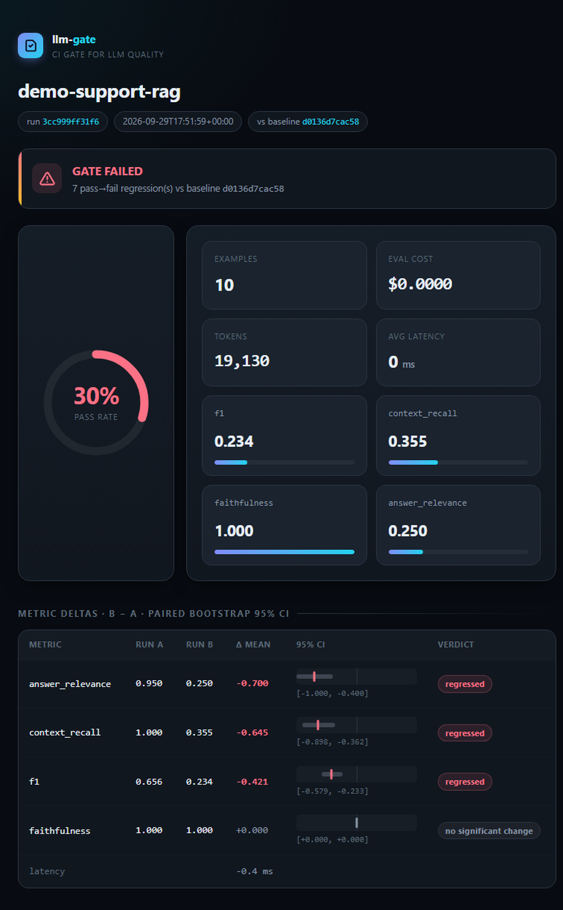
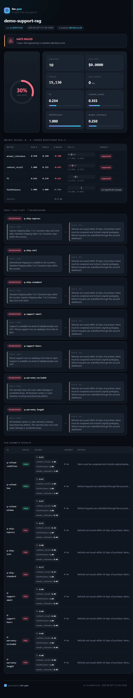
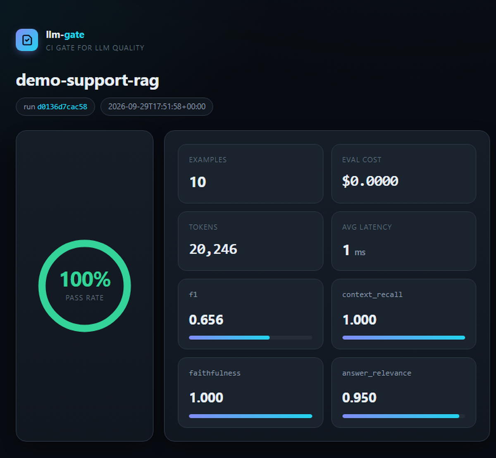

# llm-gate

**A smoke alarm for AI quality.** llm-gate tests your LLM/RAG pipeline against a checklist of questions, grades every answer automatically, and — the important part — **compares runs so a "small improvement" can never silently make your AI worse.** If anything regressed, it fails your CI build before users notice.

> Every team running LLMs in production faces the same question: *did my last prompt/model/retrieval change make outputs better or worse?* Today most teams answer with vibes and spot-checks. llm-gate answers with numbers, per-example evidence, and a confidence interval.

---

## The problem, in one picture

```
you change a prompt ──> answers shift ──> averages look "fine" (+2%)
                                          └─> but 7 specific cases broke
                                              └─> users find out first 😬
```

Averages lie. A +2% mean can hide ten newly-broken answers. llm-gate looks at **every example individually**, tells you exactly which cases flipped from passing to failing, and whether the change is statistically real or just noise.

## How it works (3 steps)

1. **Write a suite** (YAML): a dataset of questions + expected answers, your pipeline (any Python function), and metrics with pass thresholds.
2. **Run it:** `llm-gate run suite.yaml` — every question goes through your pipeline, every answer gets graded, the run is stored.
3. **Gate it:** `llm-gate diff <old-run> <new-run> --fail-on-regression` — if any example flipped pass→fail, exit code 1. Put it in CI; bad changes stop merging.

```
dataset (JSONL) ──> your pipeline ──> answers ──> metrics ──> run (SQLite)
                                                          │
                              llm-gate diff runA runB <───┘
                                        │
                        GATE PASSED / GATE FAILED (exit 0/1)
                        + HTML report with per-example evidence
```

## 60-second quickstart — no API key, no internet

```bash
pip install -e .
llm-gate run examples/suite.yaml                    # run A: working pipeline
llm-gate run examples/suite_v2_degraded.yaml        # run B: "v2 refactor" broke retrieval
llm-gate history                                    # copy the two run ids
llm-gate diff <A> <B> --fail-on-regression --report diff.html
```

The bundled demo ships two pipelines on purpose — one working, one subtly broken — so you can watch the gate catch **7 regressions** on your first try. The report opens in any browser:



## Adding an LLM judge (cloud *or* fully local)

Deterministic metrics (exact match, F1, context recall, JSON validity) are free and offline. For judgment calls — *is every claim supported by the sources? does it actually answer the question?* — llm-gate uses a second LLM as a strict examiner. It works with **any provider**, including local models:

| your setup | `judge.model` | `judge.api_base` | key needed? |
|---|---|---|---|
| Groq (free tier, fast) | `groq/openai/gpt-oss-120b` | — | `GROQ_API_KEY` |
| OpenAI | `openai/gpt-4o-mini` | — | `OPENAI_API_KEY` |
| Anthropic | `anthropic/claude-3-5-haiku-latest` | — | `ANTHROPIC_API_KEY` |
| Google Gemini | `gemini/gemini-2.0-flash` | — | `GEMINI_API_KEY` |
| **Ollama (local)** | `ollama_chat/llama3.2` | `http://localhost:11434` | none |
| **LM Studio (local)** | `openai/my-model` | `http://localhost:1234/v1` | none |
| **vLLM / llama.cpp / LocalAI** | `openai/my-model` | your server URL | none |

Anything speaking the OpenAI or Ollama HTTP API works — that's the whole ecosystem, via [litellm](https://github.com/BerriAI/litellm).

```bash
pip install -e ".[judge]"
cp .env.example .env          # put your key here (git-ignored); local setups skip this
llm-gate run examples/suite_judge.yaml        # cloud judge
llm-gate run examples/suite_ollama.yaml       # 100% local judge, zero keys
```

Judges are noisy, and llm-gate treats them honestly: `judge.samples: 2` grades each answer N times at temperature 0 and averages; judge calls are content-hash **cached**, so re-running an unchanged suite is instant and free (measured: 1.4s and $0.00 for a full 40-call re-run). One caveat worth knowing: the judge is a *general* model grading *your* specialized one. For deep domain fine-tunes it may not know your ground truth — for those assertions lean on deterministic metrics against your own references (`exact_match`, `contains`, `json_valid`, `context_recall`), and reserve the judge for open-ended quality.

## Suite format

```yaml
name: my-pipeline
dataset:
  path: data/eval-set.jsonl         # one JSON per line: {id, input, reference?, contexts?}
target:
  callable: my_module:my_function   # receives the example dict,
                                    # returns {"output": str, "contexts": [...]}
metrics:
  - name: f1
    threshold: 0.25                 # an example passes when EVERY metric >= its threshold
  - name: context_recall
    threshold: 0.5
  - name: faithfulness              # LLM judge
    threshold: 0.75
judge:
  model: groq/openai/gpt-oss-120b   # or ollama_chat/... + api_base for local
  samples: 2
  seed: 42
```

Your pipeline stays yours: llm-gate only needs one function. LangChain, LlamaIndex, raw SDK calls, a REST client — if it's callable, it's testable.

## Evaluate your own pipeline in 5 steps

**1. Export real cases.** 20–50 questions your users actually ask (prod logs, support tickets, known-good answers), one JSON per line. `reference` (expected answer) unlocks `exact_match`/`f1`; `contexts` (gold sources) unlocks `context_recall`/`faithfulness`. Both optional — include what your chosen metrics need.

```jsonl
{"id": "refund-1", "input": "How do I get a refund?", "reference": "Request it within 30 days from account settings."}
```

**2. Wrap your existing system in one function.** This is the only code you write:

```python
# my_pipeline.py
from openai import OpenAI

client = OpenAI(base_url="http://gpu-box:8000/v1")   # your endpoint, your credentials

def answer(example: dict) -> dict:
    r = client.chat.completions.create(
        model="my-finetune-v3",
        messages=[{"role": "user", "content": example["input"]}],
    )
    return {"output": r.choices[0].message.content, "contexts": []}
```

Fine-tuned, prompt-tuned, RAG, agent, ensemble — all a black box to llm-gate; it only ever sees inputs and outputs. Note the split: the **model under test** can be anything (llm-gate never calls it directly), while the **judge** is the one thing that needs a provider from the table above.

**3. Point a suite at it:** `target: { callable: my_pipeline:answer }` in `suite.yaml` (format above).

**4. Baseline:** `llm-gate run suite.yaml --report base.html` and sanity-check the report.

**5. Change something** (prompt, model version, retrieval, a new fine-tune epoch), re-run, then `llm-gate diff <base> <new> --fail-on-regression`. Per-example flips tell you *what* broke; the CIs tell you whether it's real. Wire step 4–5 into CI and every future change is gated.

## Metrics

| metric | type | what it measures |
|---|---|---|
| `exact_match` | deterministic | output == reference (whitespace-normalized) |
| `contains` | deterministic | required substrings present |
| `f1` | deterministic | token-level F1 vs reference (SQuAD-style) |
| `context_recall` | deterministic | are the answer's facts actually in the retrieved contexts? |
| `json_valid` | deterministic | structured-output validity (+ required keys) |
| `faithfulness` | LLM judge | every claim supported by the contexts (G-Eval style: reasoning, then rubric score) |
| `answer_relevance` | LLM judge | directly and completely answers the question |

## In CI (the actual point)

```yaml
- run: llm-gate run suites/prod.yaml --notes "sha=$GITHUB_SHA"
- run: llm-gate diff $BASELINE_RUN $NEW_RUN --fail-on-regression --report diff.html
```

Upload `diff.html` as a job artifact and every PR shows the quality delta in red/green. Non-zero exit code = blocked merge. LLM quality becomes a test suite, not a hope.

## Verified run (real judge, reproducible)

Ran on the bundled demo with **Groq `openai/gpt-oss-120b`** as judge (2 samples/example, temp 0):

| run | target | pass rate | faithfulness | answer_relevance |
|---|---|---|---|---|
| `d0136d7cac58` | working retrieval | 100% | 1.000 | 0.950 |
| `3cc999ff31f6` | degraded "v2 refactor" | 30% | 1.000 | 0.250 |

`llm-gate diff d0136d7cac 3cc999ff31 --fail-on-regression` → **GATE FAILED, 7 pass→fail regressions**; `answer_relevance` Δ −0.700 (95% CI [−1.000, −0.400]), `context_recall` Δ −0.645 ([−0.898, −0.362]) and `f1` Δ −0.421 ([−0.579, −0.233]), all verdict *regressed*.

An honest nuance this run demonstrates: **faithfulness stayed 1.000 in the broken run.** The degraded answers were still faithful *to the wrong contexts they were given* — only relevance + context_recall expose retrieval failure. One metric is never enough; that's the argument for a metric suite.

Every run and diff renders to a self-contained dark-theme HTML report (pass-rate ring gauge, metric cards, bootstrap-CI bars, before/after flip cards). Screenshots of these exact runs live in `reports/img/`:






## How is this different from RAGAS / DeepEval / promptfoo?

Those are excellent metric libraries and red-teamers — use them for the metric zoo. llm-gate's focus is narrower and different:

- **The diff is the product.** Per-example pass→fail flips + paired bootstrap 95% CIs on every delta, so "+2%" can't be claimed as improvement when noise explains it.
- **It's a gate, not a dashboard.** Exit codes and CI-first workflow; static HTML reports as shareable artifacts (no JS build chain, no server to run).
- **Deterministic-first, judge-second.** Anything checkable without a model is checked without one; judge calls are cached and variance-tracked.
- **Zero lock-in.** Your pipeline = one Python function; your judge = any OpenAI/Ollama-compatible endpoint, including fully local.

## Try it yourself / development

Three tracks, easiest first:

```bash
# 1. offline core + gate demo (no keys, no internet)
pip install -e .
pytest -q                                   # 30 tests, incl. stub-server provider tests
llm-gate run examples/suite.yaml

# 2. cloud judge
pip install -e ".[judge]" && cp .env.example .env   # add your key
python scripts/judge_smoke.py               # verifies key, model, JSON, cost, cache
llm-gate run examples/suite_judge.yaml

# 3. fully local judge (Ollama)
ollama pull llama3.2
llm-gate run examples/suite_ollama.yaml
```

```bash
pip install -e ".[dev]"
pytest -q && ruff check src tests && mypy src
```

## Design notes

- **Static HTML reports, no web dashboard (v1).** Shareable as a file, diff-able as a CI artifact. A live dashboard is a v2 concern.
- **SQLite run store** (`.llm-gate/store.db`), queryable with DuckDB when installed.
- **Cost accounting.** Tokens and USD tracked per run; evals cost money and should say so.
- **Provider tests run against local stub servers** emulating the OpenAI and Ollama wire formats — compatibility is verified, not assumed.

## Roadmap

- [ ] Pairwise judge comparisons with position swapping (A/B answer preference)
- [ ] RAGAS/BEIR dataset importers
- [ ] Semantic caching of target calls (not just judge calls)
- [ ] `llm-gate watch` — re-run only examples affected by a prompt diff

## License

MIT
